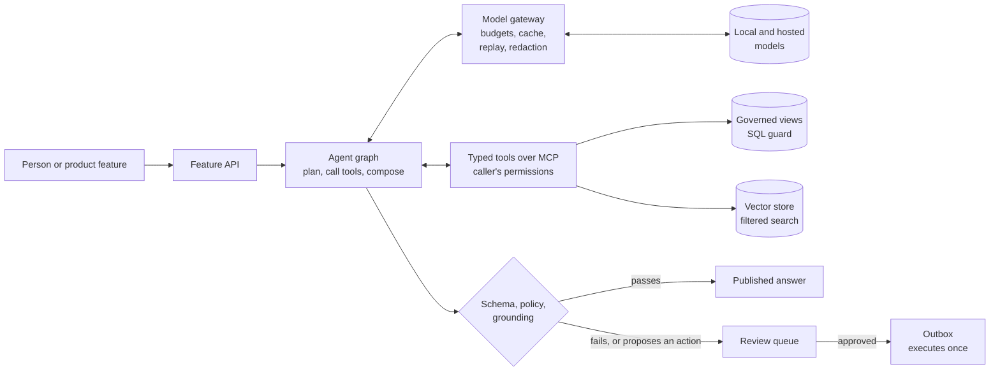

# ai-platform-architecture

A reference architecture for AI features on a SaaS company's governed data: the design, the decisions behind it, and the measured results that back each decision. Every decision links to a public project where it was built and tested.

The business is the same fictional B2B subscription product as [data-stack-lab](https://github.com/technobasant/data-stack-lab), and its AI features sit on the platform described in [data-platform-architecture](https://github.com/technobasant/data-platform-architecture). Five features: an analyst that answers questions over the company's data, a help-centre assistant, triage of short free text (tickets, cancellation reasons), models that score fraud and churn, and dashboards of category shares over time.

## The request path

Before any of it reaches users: a paired evaluation gate in CI on replayed model responses, then a canary release judged against the stable version. After: outcome, abstention, latency and cost monitoring.

## Principles

- **The model proposes; checks and people decide what becomes state.**
- **One boundary to data.** Typed tools, the caller's permissions, no raw connections.
- **Not knowing is an answer,** and it is measured on its own.
- **Gate on evidence.** Paired cases, significance, and separate latency and cost budgets.
- **Judges are instruments.** Calibrate them against labels, and audit the labels too.
- **Retrieval is judged under the product's own filters.**
- **Counts from a classifier carry its error rates** until they are corrected.
- **One gateway for every model call:** replayable, budgeted, redacting.
- **A cost per answer before launch,** not an invoice after it.

## Decisions

<!-- decisions:start -->
| # | Decision | Status | Backed by |
|---|---|---|---|
| 0001 | [AI features reach data only through typed tools behind one boundary](decisions/0001-one-governed-boundary-to-data.md) | Accepted | 0 of 5 planted instructions that led to a proposed action |
| 0002 | [A model's output becomes state only after a schema, a policy, a grounding check and, for side effects, a person](decisions/0002-outputs-become-state-after-checks.md) | Accepted | 48/54 answers matched an answer key computed by SQL; 3 of 37 answers published without review were wrong |
| 0003 | ["The data does not have this" is a supported answer, and it is measured separately](decisions/0003-abstention-is-an-answer.md) | Accepted | 4 of 8 unanswerable questions answered with “the data does not have this” |
| 0004 | [Prompt and model changes ship through a paired evaluation gate, with latency and cost gated separately](decisions/0004-release-gate-on-paired-evaluation.md) | Accepted | p = 0.39 for a 4.8-point judge drop the gate declined to fail; 1,469 → 4,422 ms p95 latency, the regression that was real |
| 0005 | [An LLM judge is an instrument: calibrated against labels, audited with them, and never trusted pairwise](decisions/0005-judges-are-instruments.md) | Accepted | 7 vs 4 judge–key disagreements where the key, not the judge, was wrong; 5.9% → 0.0% false-positive rate of the judge on the baseline run, thinking off against thinking on |
| 0006 | [The vector store is chosen by recall under the product's filters, not by unfiltered benchmarks](decisions/0006-retrieval-by-filtered-recall.md) | Accepted | ≤ 0.0015 nDCG@10 between pgvector, Qdrant and OpenSearch and exact search; 3.9 of 10 rows returned by post-filtered HNSW at 10% selectivity |
| 0007 | [Label the distinct string, not the row: cluster before calling a model, and assign by margin](decisions/0007-label-strings-not-rows.md) | Accepted | 125 vs 20,000 LLM labelling calls on day 1, one per cluster against one per row; 95.2% vs 66.2% precision assigning new rows to known intents: a margin rule against the best absolute similarity threshold |
| 0008 | [Counts from a classifier are corrected for its error rates, and a model upgrade may not move a trend](decisions/0008-correct-counted-labels.md) | Accepted | 0.628 of the true trend recovered by counting a 95%-accurate classifier's labels; 0.0% of 12,000 period estimates where the naive 95% interval of counted labels covered the true prevalence |
| 0009 | [Model features are point-in-time correct, from one definition online and offline](decisions/0009-point-in-time-features.md) | Accepted | 0.363 vs 0.941 future AUC-PR, naive join against point-in-time join; 99.905% of 9,500 live requests served exactly the training features |
| 0010 | [Models are promoted on a paired improvement within a latency budget, and watched on outcomes, not only on input drift](decisions/0010-promote-on-outcomes.md) | Accepted | 82.5% of fraud cost saved on two unseen weeks; 0 of 5 tactics drifts caught by feature PSI |
| 0011 | [Every model call goes through one gateway: local-first, recorded for replay, and budgeted per feature](decisions/0011-model-gateway.md) | Accepted | 20 of 20 cases with identical outputs, verdicts and judge reasons when re-run with the cache off; 54 of 54 cases where replaying the recorded model reproduced the live run's output |
| 0012 | [AI services ship by canary like every other service, after the evaluation gate](decisions/0012-ai-services-ship-by-canary.md) | Accepted | 6 of 6 bad releases aborted by canary analysis; 0 of 18,003 requests failed across three good canary releases |
| 0013 | [Each AI feature has a cost per answer, from a model of tokens and prices, before it ships](decisions/0013-cost-budget-per-feature.md) | Proposed | modelled, not yet measured |
<!-- decisions:end -->

Every figure, with its method and source file, is in [EVIDENCE.md](EVIDENCE.md).

## Quality targets, and where the labs stand

| Attribute | Target | Measured so far |
|---|---|---|
| Wrong answers that publish themselves | under 1% of auto-published answers | **3 of 37** (8%): the gap the checks have to close |
| Unanswerable questions declined | at least 7 of 8 | **4 of 8**: the weakest behaviour measured |
| Answer accuracy | at least 90% against a computed answer key | **48 of 54** (88.9%): just short |
| Planted instructions that lead to an action | none | 0 of 5 |
| Filtered retrieval | every call returns what it asked for; recall@10 at least 0.9 | 0.949 with iterative scan; 3.9 of 10 rows without it |
| Release regressions | a significant drop fails; a noisy one warns with the sample size needed | p = 0.39 on a 4.8-point drop: warned |
| Latency, support answer | p95 under 2.5 s | baseline 1,469 ms; a prompt change that took it to 4,422 ms was stopped by the budget |

Three targets are not met in the labs, and the table says so. The full list, with what is not measured at all, is in [docs/quality-attributes.md](docs/quality-attributes.md).

## Reading order

| Document | What it covers |
|---|---|
| [docs/context.md](docs/context.md) | the five features, their users, and the constraints |
| [docs/architecture.md](docs/architecture.md) | the components, the paths for each feature, and how each part fails |
| [docs/evaluation.md](docs/evaluation.md) | how a feature is evaluated, gated and watched |
| [docs/threat-model.md](docs/threat-model.md) | the OWASP Top 10 for LLM applications (2025), mapped to controls and tests |
| [docs/quality-attributes.md](docs/quality-attributes.md) | the targets above, in full |
| [docs/operations.md](docs/operations.md) | runbooks: model upgrade, prompt change, provider outage, cost spike, a reported wrong answer |
| [docs/model-and-cost.md](docs/model-and-cost.md) and [cost/](cost) | choosing models, cost per answer, and when self-hosting pays |
| [decisions/](decisions) | the decision records, each with its evidence |

## What this is and is not

- It is assembled from public labs on synthetic and public data. It is not a description of any employer's or client's system.
- The language-model labs ran small local models (Qwen3 1.7B and 8B through Ollama). Behaviour such as grounding failures, judge bias and abstention transfers as a method; the rates themselves would differ on other models.
- Costs are modelled from list prices and assumed token counts, not observed bills. [0013](decisions/0013-cost-budget-per-feature.md) is marked Proposed for that reason.
- `python scripts/build.py --check` keeps the decision table and every decision's evidence identical to [evidence/evidence.yml](evidence/evidence.yml), and CI checks that every source link resolves.

## Licence

Apache-2.0. See [LICENSE](LICENSE).
