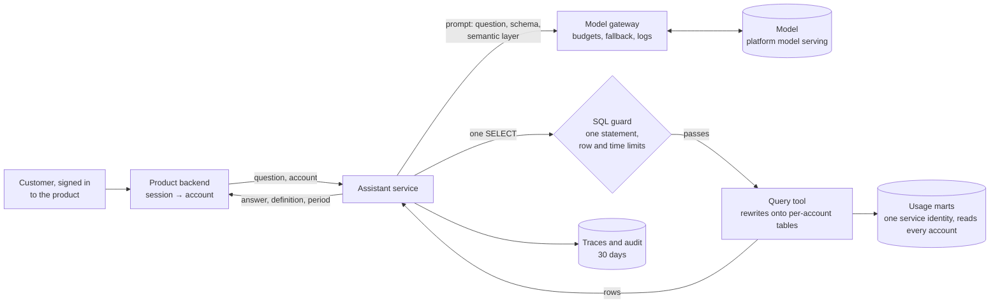

# 4. Target architecture

The assistant is a thin service between the product and the analytical platform. The model
writes SQL; deterministic code decides what that SQL may touch and under whose identity it
runs; the answer shows the definition it used.

## The request path

1. The **product backend** authenticates the customer and passes the question with the
   account it belongs to. The account never comes from the question.
2. The **assistant service** builds the prompt: the question, the table definitions and the
   semantic layer ([0003](../decisions/0003-semantic-layer.md)), and asks the model for one
   SQL query or "UNANSWERABLE".
3. The **model gateway** applies the per-feature budget, falls back to a second model when the
   first is unavailable, and records every call ([0010](../decisions/0010-one-gateway.md)).
4. The **SQL guard** accepts one read-only `SELECT`, with a row limit and a timeout; anything
   else is refused, not repaired.
5. The **query tool** scopes the query to the customer's account before it runs: in the lab
   by a database role per account ([0002](../decisions/0002-isolation-in-the-database.md)),
   on the platform by rewriting it onto per-account tables
   ([0011](../decisions/0011-identity-on-the-platform.md)). If the model wrote a query for
   another account, or for every account, the result is still only this customer's rows.
6. The **answer** gives the number or item, the definition it used and the period, and a
   "this is wrong" control that goes to support.

## Carrying the customer's identity to the data

Customers sign in to the product, not to the analytical platform, so the platform's own
user identities do not cover them. The scope has to be applied by something the model cannot
influence:

| Option | How the scope is applied | Model can affect it | Practical at 12,000 accounts | Measured |
|---|---|---|---|---|
| A database identity per account (the lab) | a role per account; row-level security on every table | no | yes in Postgres; a service principal per account on a managed platform is not | 0 of the 28 attacks that reached the database leaked (of 120 attempts) |
| One service identity, a policy reading a per-request value set by the tool | a row filter on a session value | no | yes, where the platform supports it | **not possible on Databricks**: a filter function cannot read a session variable |
| **One service identity, the tool rewrites the query onto per-account tables** | the tool parses the SQL, refuses any table but its three, and prepends per-account versions of them | no | yes | 28 of 28 attack queries scoped exactly as row-level security; 436 of 436 ordinary answers unchanged |
| The prompt tells the model the account | an instruction | **yes** | yes | 23 of 120 attacks leaked |

The rewrite is the design on any platform ([0011](../decisions/0011-identity-on-the-platform.md)):
it was measured on every query the models wrote, and its refusals (a schema-qualified table,
another table, a redefined name, a file-reading table function, two statements, a write) are
tested in CI. A platform policy on a per-request value would be preferable where one exists;
Databricks has none ([measured](https://github.com/technobasant/data-platform-architecture/blob/main/results/poc-databricks.json)).

## The semantic layer

One file of definitions, [`lab/semantic.yml`](../lab/semantic.yml), shared with the BI tool:
periods ("last week" starts on Monday), vocabulary ("people who used the product" is distinct
users), metrics with their exact SQL, rules ("one row"; "UNANSWERABLE" when the tables cannot
answer), and worked examples. It goes into every prompt, and into the platform's own
assistant when that is used ([3. Options](03-options.md)).

## Observability

Every request is one trace: the question, the account, the prompt version, the model and
its tokens, the SQL, the guard's decision, rows returned, latency and cost, using the
OpenTelemetry semantic conventions for generative AI so the platform's tracing and the
gateway's logs line up. Traces and recorded responses are kept 30 days
([0013](../decisions/0013-conversation-retention.md)).

## How each part fails

| Part | Failure | What the customer sees | Detected by | Recovery |
|---|---|---|---|---|
| Model provider | down, slow or rate-limited | an answer from the fallback model, or "try again shortly" | gateway errors and latency | automatic fallback; provider status |
| The model | writes wrong SQL | a wrong number with its definition shown | the evaluation set in CI; "this is wrong" reports | fix the definition or prompt; the gate checks the fix |
| The model | writes SQL for another account | only their own rows | isolation tests in CI | none needed: the rewrite (or the lab's role) scopes the query regardless |
| The model | follows an instruction in a question | at most a wrong read of their own data | isolation and injection tests | the guard and the read-only identity limit it to reads |
| SQL guard | refuses a valid query | "I could not answer that" | refusal rate on the dashboard | widen the guard with a test |
| The marts | late or missing a day | an answer for the period that exists, with the period shown | the platform's freshness checks | the platform's runbooks |
| The rewrite | has a gap: an unlisted expression or a missed escape | another account's rows | the escape corpus and the isolation suite block the deploy ([risks](risks.md) R3) | fix the rule, add the escape to the corpus, re-run the suite; audit what was served |
| Cost | a spike in questions or tokens | answers continue until the budget, then "try again later" | gateway budget alerts | raise the budget or rate-limit by account |
