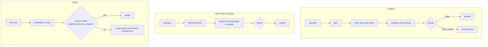

# Architecture

## Components

| Component | What it does | Decision |
|---|---|---|
| Feature API | authenticates the caller and carries their tenant and permissions into every call | [0001](../decisions/0001-one-governed-boundary-to-data.md) |
| Agent graph | an explicit graph of steps (plan, call tools, compose, check), not a free loop around the model | [0001](../decisions/0001-one-governed-boundary-to-data.md) |
| Model gateway | the only path to models: credentials, retries, timeouts, fallbacks, cache, record and replay, budgets, redaction | [0011](../decisions/0011-model-gateway.md) |
| Tool server (MCP) | typed tools with schemas, run under the caller's permissions | [0001](../decisions/0001-one-governed-boundary-to-data.md) |
| SQL guard | parses SQL the model wrote and allows only listed statements and governed views | [0001](../decisions/0001-one-governed-boundary-to-data.md) |
| Retrieval | a vector store queried with the tenant and product filters, checking it got the rows it asked for | [0006](../decisions/0006-retrieval-by-filtered-recall.md) |
| Output checks | schema validation, policy rules, and a deterministic grounding check of quoted numbers against tool results | [0002](../decisions/0002-outputs-become-state-after-checks.md) |
| Review queue and outbox | what fails a check, or proposes an action, waits for a person; approved actions execute once | [0002](../decisions/0002-outputs-become-state-after-checks.md) |
| Evaluation harness | paired runs, judges calibrated against labels, significance, latency and cost budgets | [0004](../decisions/0004-release-gate-on-paired-evaluation.md), [0005](../decisions/0005-judges-are-instruments.md) |
| Feature store | point-in-time features offline and online for scoring models | [0009](../decisions/0009-point-in-time-features.md) |

## Paths

Scoring models run in the request path behind the feature store, outside the model gateway; category trends are estimated in the warehouse from classifier outputs and a small labelled sample per period ([0008](../decisions/0008-correct-counted-labels.md)).

## How each part fails

| Part | Failure | Detected by | Response | Evidence |
|---|---|---|---|---|
| Model output | plausible but wrong answer | grounding check; review; evaluation | held for review if a check fails; 3 of 37 wrong answers still passed every check | [0002](../decisions/0002-outputs-become-state-after-checks.md) |
| Model output | answers a question the data cannot answer | unanswerable cases in the evaluation set | typed abstention; declined 4 of 8 | [0003](../decisions/0003-abstention-is-an-answer.md) |
| Data | planted instructions | output checks; tools cannot act | 0 of 5 led to an action | [0001](../decisions/0001-one-governed-boundary-to-data.md) |
| Retrieval | a filter silently starves the result | rows returned against rows asked | iterative scan; 3.9 of 10 rows without it | [0006](../decisions/0006-retrieval-by-filtered-recall.md) |
| A prompt or model change | quality or latency regression | paired gate with budgets | warned on a noisy drop; failed a 3× latency rise | [0004](../decisions/0004-release-gate-on-paired-evaluation.md) |
| A judge | biased verdicts | calibration against audited labels | reasoning judge where it matters; pairwise never gates | [0005](../decisions/0005-judges-are-instruments.md) |
| A provider | outage or rate limit | gateway errors and latency | fallback model through the gateway; cached answers where valid | [0011](../decisions/0011-model-gateway.md) |
| A scoring model | silent degradation | outcome monitoring | input drift (PSI) caught 0 of 5 tactic changes; outcomes are the alarm | [0010](../decisions/0010-promote-on-outcomes.md) |
| A release | bad deployment | canary against stable | 6 of 6 bad releases aborted | [0012](../decisions/0012-ai-services-ship-by-canary.md) |
